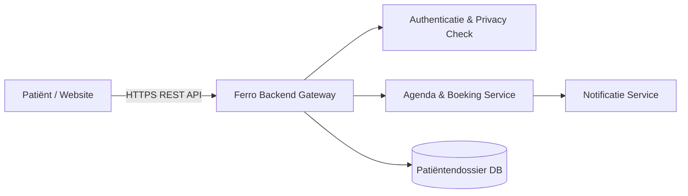

# Ferro — Tandartspraktijk Backend API 🦷

> Het centrale backend-platform voor online afspraken, patiëntenbeheer en automatische herinneringen van **Tandartspraktijk Ferro**.


---

## 📌 Over het Backend Product

De **Ferro Tandarts API** vormt de motor achter de digitale dienstverlening van de praktijk. Het systeem verwerkt veilig medische data, synchroniseert agendas en regelt de communicatie tussen patiënten en tandartsen.

* **🗓️ Slim Afsprakenbeheer:** Real-time beschikbaarheid van behandelaren en stoelen ophalen en boeken.
* **📲 Automatische Herinneringen:** Aanloggen en versturen van SMS- en e-mailnotificaties voor periodieke controles.
* **🔒 Veilig Patiëntenportaal:** Geëncrypteerde gegevensuitwisseling voor behandelplannen en medische historie.
* **💳 Facturatie & Declaratie:** Automatische koppeling met zorgverzekeraars en declaratiesystemen.

---

## ⚙️ Systeemarchitectuur



---

## 💻 API Demo (Afspraak Boeken)

Een voorbeeld van een backend-aanroep waarmee een patiënt een controle-afspraak inplant:

```bash
curl -X POST [https://api.tandartspraktijkferro.nl/v1/afspraken](https://api.tandartspraktijkferro.nl/v1/afspraken) \
  -H "Authorization: Bearer PATIENT_TOKEN" \
  -H "Content-Type: application/json" \
  -d '{
    "patient_id": "P-98765",
    "behandeling": "Periodieke Controle",
    "datum": "2026-11-20T10:30:00Z"
  }'
```

**Verwacht antwoord (JSON):**
```json
{
  "status": 201,
  "afspraak_id": "AFS-10294",
  "behandelaar": "Dr. Ferro",
  "bevestigde_tijd": "2026-11-20T10:30:00Z",
  "herinnering_ingesteld": true
}
```

---

## 👥 Het Team (Ferro Marketing & Product)

| Rol | Naam | GitHub Account |
| :--- | :--- | :--- |
| **Manager** | Maya | [@MayaKahlous](https://github.com/MayaKahlous) |
| **Chef Marketing** | Anastasia | [@AnastasiaIro](https://github.com/AnastasiaIro) |
| **Chef Product** | Alessandra | [@alessandrakuilboer](https://github.com/alessandrakuilboer) |
| **Chef Kwaliteit** | Livia | [@LiviaUsername](https://github.com/LiviaUsername) |

---

📬 **Contact:** Vragen over de koppeling met tandheelkundige software? Neem contact op met het Ferro-ontwikkelteam.
